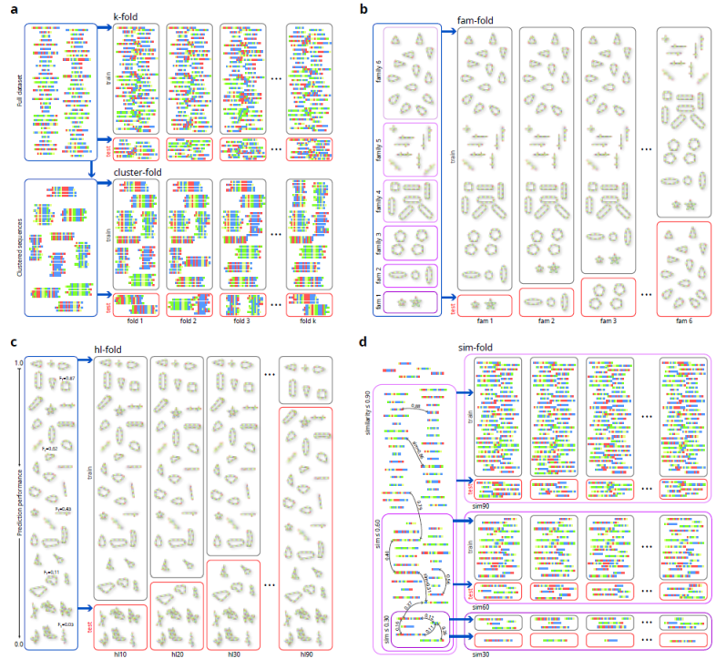
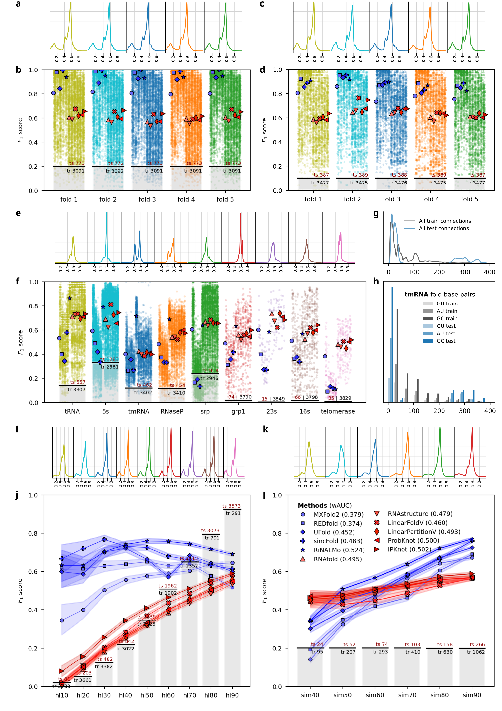

# Homology-aware cross-validation strategies for generalization assessment in RNA secondary structure prediction

This repository contains the data and source code for the manuscript *Homology-aware cross-validation strategies for generalization assessment in RNA secondary structure prediction*, by L.A. Bugnon, G. Kulemeyer, M. Gerard, L. Di Persia, G. Stegmayer and D.H. Milone, 2026 (under review). Research Institute for Signals, Systems and Computational Intelligence, [sinc(i)](https://sinc.unl.edu.ar/).

**Preprint:** [bioRxiv, doi:10.64898/2026.06.28.735057](https://www.biorxiv.org/content/10.64898/2026.06.28.735057)

In this work we revise existing cross-validation strategies for RNA secondary structure prediction: random k-fold, clustering fold and family fold. 
We explain and analyze in detail the advantages and disadvantages of each one of them, additionally proposing two novel evaluation methodologies for testing: human-learned fold and similarity fold. 

All validation strategies are applied to state-of-the-art methods for RNA secondary structure prediction and comparative results are analyzed.

## Cross-validation methodologies for RNA secondary structure prediction revised

  
  

**a)** Random **k-fold**: (top) the complete dataset is randomly divided into k groups, in a fold a group is used for testing (red) and the rest for training (gray). 

In **cluster-fold** (bottom), the complete dataset is split into clusters of similar sequences, in a fold a subset of them is assigned to the training set, and the rest is used for testing. 

**b) fam-fold**: the illustration has 6 structural families (triangles, lines, etc.). At each fold, one complete family is left out and used only for testing, while all the others are used for training.

**c) hl-fold**: in each fold, the training set contains all the sequences for which the mean F1 of four classical thermodynamic methods is above a threshold, and the remaining sequences are used for testing. Several thresholds define the folds. 

**d) sim-fold**: groups of increasing sequence similarity are built, then inside each group many random train/test folds can be sampled.

## Performance comparison for RNA secondary structure prediction methods according to different cross-validation strategies

  
  
  

**k-fold**: a) distribution of test-to-train structural distances of each fold; b) median F1 for each prediction method (DL methods in blue, classical methods in red). Gray bars show the proportion of test to train sequences. 

**cluster-fold**: c) test-to-train distance distributions; d) structure prediction performance. 

**fam-fold**: e) test-to-train distance distributions; f) structure prediction performance. 

Analysis of connection distances for tmRNA family used in test set of fam-fold strategy: g) distribution of distances between bases of canonical pairs in the reference structures of training (gray) and testing (blue) partitions; h) distribution of connection distances for canonical base pairs GU, AU and GC. 

**hl-fold**: i) test to train distance distributions; j) median F1 performance for each prediction method, with the 95% confidence interval shaded behind each trend line. 

**sim-fold**: k) test-to-train distance distributions; l) structure prediction performance. wAUC: area under the performance curve for each method, weighted by the difficulty of the partition.

## Reproducible research
Main results in Figure 2:
- [This notebook](https://colab.research.google.com/github/sinc-lab/xvalRNAfolding/blob/main/src/Figure_2_dist_dist.ipynb) shows the train-to-test structural distance distributions of each cross-validation strategy. 

- [This notebook](https://colab.research.google.com/github/sinc-lab/xvalRNAfolding/blob/main/src/Figure_2_strips_plot.ipynb) shows performance comparison of prediction methods among different cross-validation strategies. 
<!-- The per-sequence $F_1$ scores it plots are computed from `data/` and `predictions/` by `src/summaries.py` on first use and cached in `results/` (not part of the repository); `python src/summaries.py` builds them all at once. -->

- [This notebook](https://colab.research.google.com/github/sinc-lab/xvalRNAfolding/blob/main/src/Figure_2_connections_dist.ipynb) plots the distribution of train and test connection distances, and the detail for base pairs GU, AU and GC in tmRNA family.

Supplementary material:

- [This notebook](https://colab.research.google.com/github/sinc-lab/xvalRNAfolding/blob/main/src/Figure_2_strips_plot.ipynb) (the same one used for Figure 2): Figure S1, critical difference diagrams; Figure S2, stratified k-fold; and Figure S7, results on bpRNA.
- [This notebook](https://colab.research.google.com/github/sinc-lab/xvalRNAfolding/blob/main/src/Figure_S3_cluster_analysis.ipynb): Figure S3, multi-threshold cluster-fold.
- [This notebook](https://colab.research.google.com/github/sinc-lab/xvalRNAfolding/blob/main/src/Figure_S5.ipynb): Figure S5, per-sequence correlations between methods.
- [This notebook](https://colab.research.google.com/github/sinc-lab/xvalRNAfolding/blob/main/src/Figure_S6.ipynb): Figure S6, per-sequence $F_1$ against the maximum similarity to the training set at sim90.
- [This notebook](https://colab.research.google.com/github/sinc-lab/xvalRNAfolding/blob/main/src/Tables_S1_S2_S3.ipynb): Tables S1, S2 and S3.

### Data

The directory `data/` has one folder per dataset, with the sequences and structures (`<dataset>.csv`), and one split file per cross-validation strategy. Each split file lists, for every fold, the partition (`train`, `valid` or `test`) of each sequence `id`; sim-fold has one file per similarity threshold.

If you want to run the notebooks or scripts locally, you may need to download the folowing data  into `data/<dataset>/distances/`:

| File | Dataset | Content | Size |
|---|---|---|---|
| [seqsim_f_all.h5](https://drive.google.com/file/d/1qLPI9ePyUksuJ7eu3Q8PV-kIMhC5NXDC/view) | ArchiveII | sequence similarity (IDscore) | 127 MB |
| [rnadist_f_all.h5](https://drive.google.com/file/d/1qVk5IRY8_JgVFIuPVZg4MCsYNVm-kNGe/view) | ArchiveII | structural distance | 127 MB |
| [archiveII-blastn-allvall-nofilter.tsv](https://drive.google.com/file/d/1z3AOAutA0tsU16wnIrge6PhkByPk7IXj/view) | ArchiveII | blastn identity (all pairs) | 58 MB |
| [bprna_seqsim_full_ACGU.h5](https://drive.google.com/file/d/1YjRZgRwjp-MdpLjXdHaIEk62HbGIXS4r/view) | bpRNA | sequence similarity (IDscore) | 1.4 GB |
| [bprna_rnadist_full.h5](https://drive.google.com/file/d/1jPHR_eBI6dB3CCCEjz7FbAVGiNxrujPV/view) | bpRNA | structural distance | 1.4 GB |

### Split generation

The code that generated the splits in `data/` is in `src/split_gen/`

#### k-fold

The sequences are randomly divided into 5 folds, so each sequence is in the test set of exactly one fold (20% of the sequences per fold). In each fold, 10% of the remaining sequences are used for validation and the rest for training.

- **ArchiveII** (`random_kfolds_split.csv`): We use the  [dl-rna release](https://github.com/marcellszi/dl-rna/releases) (Szikszai et al., 2022). `archiveII/kfold+famfold_splits.ipynb` downloads the release (`ct-splits.tar.gz`, checked by its sha256), converts its directory tree of `.ct` files to CSV.
- **bpRNA** (`random_kfolds_split.csv`): `bpRNA/random_kfold.ipynb`, with scikit-learn `KFold`.
- **Stratified k-fold**, (`stratified_kfold_split.csv`, Figure S2): `archiveII/stratified_kfold.ipynb`. The same scheme, with `StratifiedKFold` on the family, so each family has the same proportion in every test set.

#### cluster-fold

The sequences are clustered by sequence identity. For each of the 5 folds, the clusters are shuffled and distributed in either train, val or test. 

- **ArchiveII multi-threshold** (`multithreshold_clustering/clustering_<tool>_<th>_folds_split.csv`, Figure S3): `archiveII/make_clustering_folds.py <th> <tool> [--reps]`. cd-hit-est (`cdhit`) covers 80% to 100% identity, its lower limit for nucleotides, and psi-cd-hit (`psi`), based on BLAST alignments, covers 30% to 80%. With `--reps` (`cdhitrep`, `psirep`) only the representative of each cluster is kept.
- **bpRNA** (`clustering_folds_split.csv`): `bpRNA/clustered_kfold.ipynb`, from the cd-hit-est 80% clustering in `data/bpRNA/threshold_clustering/bpRNA-cdhit_0.8.clstr` (`-c 0.8 -n 5 -g 1 -d 100`). 

#### fam-fold

In each fold, all the sequences of one family are left out for testing, and the model is trained on the other families.

- **ArchiveII** (`fam_folds_split.csv`): the 9 family folds of the dl-rna release, converted by the same notebook as k-fold. Each test set is one whole family.
- **bpRNA** (`fam_folds_train_split.csv`, `fam_folds_test_split.csv`): `bpRNA/famfold.ipynb`. Here the testing families come from bpRNA-new sequences, Rfam families not in bpRNA. `fam_folds_train_split.csv` has this single partition. `fam_folds_test_split.csv` divides the test set by family. Needs the Rfam 14.2 family of each bpRNA-new sequence, `data/bpRNA/families_bpRNA-new/bprna-new_ID_to_Type_Rfam14_2.csv`.

#### hl-fold

Each sequence is scored with the mean $F_1$ of four classical thermodynamic methods (RNAfold, RNAstructure, LinearFoldV and LinearPartitionV), as a measure of how hard it is to predict them. For a threshold $t$, the test set is the sequences with mean $F_1$ below $t$, and the others are used for training and validation. The procedure is the same for both datasets (`archiveII/hl_subsets.ipynb`, `bpRNA/hl_subsets.ipynb`). Needs the per-sequence $F_1$ of the classical methods, `results/<dataset>/classical_summary.pkl`, which `python src/summaries.py` builds from `predictions/`.

#### sim-fold

For a similarity threshold $t$, only the sequences whose sequence similarity with every other sequence of the dataset is below $t$ are kept, so no pair of sequences in the subset reaches $t$. The subsets go from 40% to 90% (`sim_folds_split/sim<t>.csv`), and each one is split in 10 folds. `sim_folds.ipynb` generates them for one dataset at a time (set `DATASET`). Needs the sequence similarity matrix of the dataset in `data/<dataset>/distances/` (see the download links above).

#### Distance matrices

- **Sequence similarity** (`seqsim_f_all.h5`, `bprna_seqsim_full_ACGU.h5`), used to build the sim-folds: the IDscore of a local alignment (Biopython `pairwise2`), that is, the number of identical positions divided by the length of the whole alignment, including the unaligned ends.  `bpRNA/seqsim/compute_sequence_similarity.ipynb` computes it in chunked rows `python bpRNA/seqsim/seqsim.py --chunk <k>`.
- **Structural distance**, ArchiveII (`rnadist_f_all.h5`): `archiveII/rnadist_all.ipynb`. RNAdistance (ViennaRNA) between every pair of reference structures, with removed pseudoknots, divided by the length of the longest structure.
